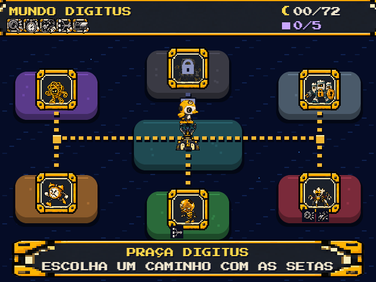
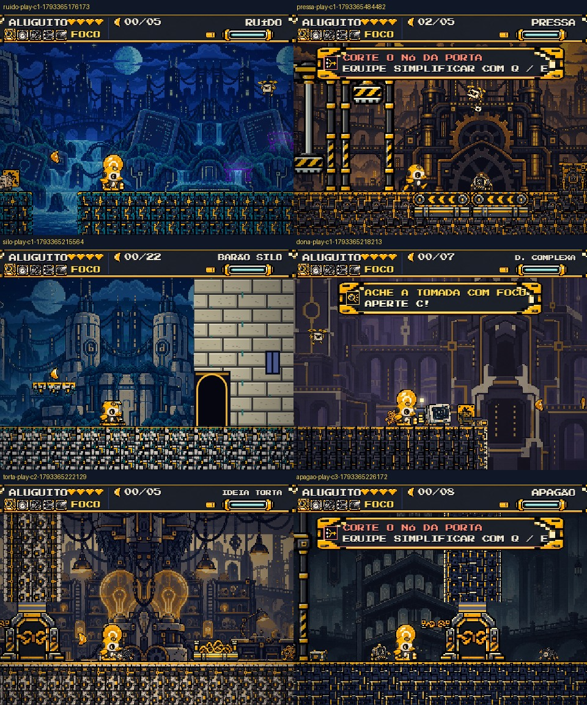
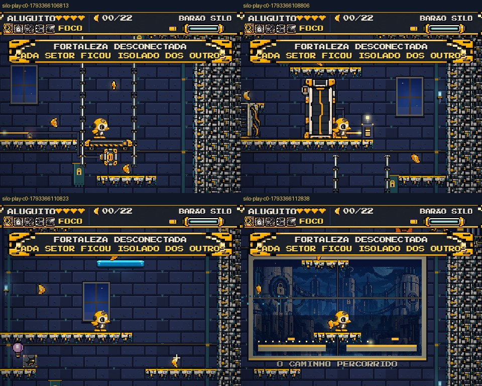
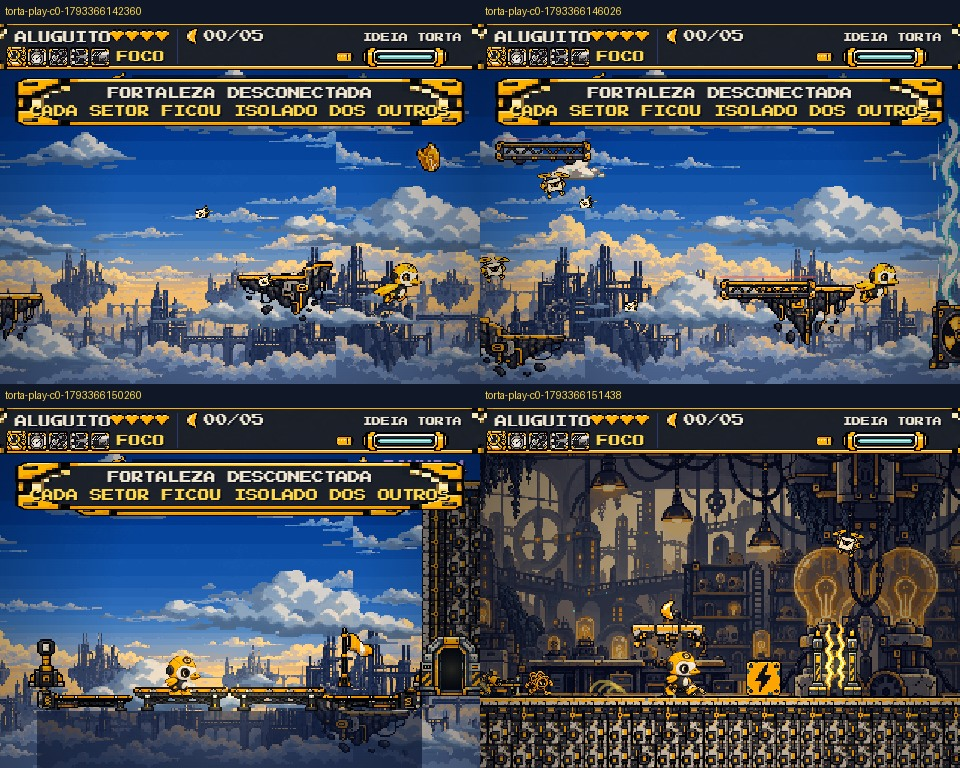
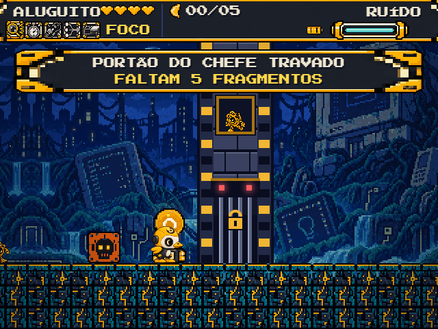
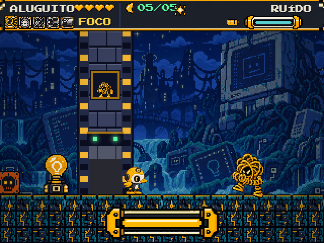
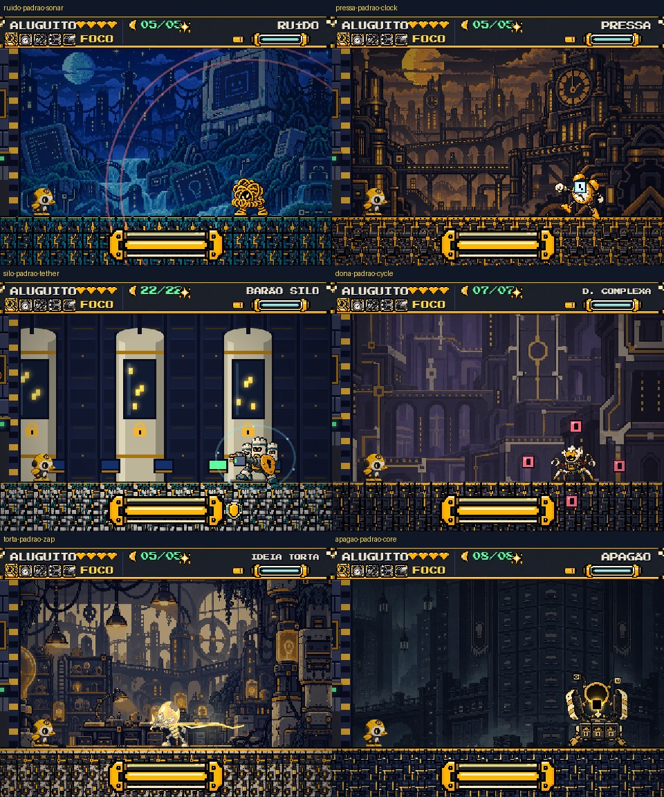

# Aluguito — revisão do mapa, fases individuais e chefes

30/10/2026. Fonte principal: repositório `alugo_the_game-completo/alugo_the_game`, branch local `main`, remoto `https://github.com/alugoideias/alugo_the_game.git`.

Esta revisão amplia a auditoria inicial, que cobria somente parte da fase 1-1. Foram abertos o mapa inicial e o mapa com os cinco chefes vencidos, os checkpoints das seis fases individuais, as seis arenas e padrões dos cinco chefes e das duas formas do Apagão. Também foram examinados quatro andares da torre, a flutuação/saída do canal e a sequência de voo → pouso → entrada na Oficina.

**Método:** cópia local instrumentada, com botões visíveis para selecionar fases, checkpoints, posições e ataques. Foram usados invulnerabilidade e avanço controlado de quadros. Isso permite inspecionar o conteúdo e reproduzir lógica, mas não equivale a zerar a campanha em condições normais nem valida todo salto, coletável ou combinação de ferramentas. O `index.html` original foi preservado. Os atalhos estão somente em `revisao-local`, fora deste repositório final.

A origem e o hash do arquivo estão em [proveniencia.json](proveniencia.json). Os resultados dos testes controlados estão em [verificacoes.json](verificacoes.json). A primeira pasta recebida continha imagens embutidas; a versão final usa imagens externas. Os principais achados foram revalidados na versão final.

## O que corrigir primeiro

| Prioridade | Problema | Evidência | Correção e aceitação |
|---|---|---|---|
| P1 | Ritmo multiplica a rajada de ponteiros do Pressa | Teste `PRESSA_THROW_SLOW`: 4 projéteis normalmente; 10 com `slow=600` | Disparar uma vez por evento, detectando a passagem do tempo pelo limiar ou marcando eventos já emitidos. Ritmo deve alterar o tempo, mantendo a quantidade da mesma rajada. Repetir também em fúria. |
| P1 | A porta parece aberta durante uma luta, embora bloqueie a passagem | `gateOpen=true`, `arenaLocked=true`, célula de passagem `W`; o desenho não mostra barras e usa luz verde | Separar “liberada para entrar” de “selada para combate”. Quando a arena estiver bloqueada, desenhar a folha/barras fechadas e sinal correspondente. Arte e colisão devem mudar juntas. |
| P2 | Mensagens da fase anterior podem aparecer na abertura aérea | `startStage()` não limpa `signText`/`need`; `stepAir()` retorna antes da atualização dos avisos de solo | Limpar mensagens contextuais na troca de fase e suprimir dicas de obstáculos terrestres durante o voo/diálogo. As capturas finais mostram “Fortaleza Desconectada” durante o voo da Oficina, após visitar Silo. Outra captura registrou aviso de 7 fragmentos na Oficina, que possui 5. Reproduzir também pela saída normal ao mapa e entrada na Oficina. |
| P2 — decisão de design | O apagamento do Apagão deixa um rebaixo, não um buraco | `APAGAO_FLOOR_ERASE`: linha 12 vira `.`, mas linhas 13 e 14 permanecem `#` | Se o ataque deveria abrir uma queda, remover/restaurar a coluna de piso prevista. Se o rebaixo de 16 px for intencional, desenhar e explicar como rebaixo, sem prometer um abismo. Não alterar sem escolher o comportamento desejado. |
| P2 — ritmo de fase | Silo não tem checkpoint no miolo da escalada | Checkpoints em `(3,68)`, `(64,68)` e `(88,12)`; 56 linhas/896 px entre os níveis de chão inferior e superior | Propor checkpoint após o elevador e outro antes da galeria azul. Escolher os patamares exatos após teste de fluxo; não colocar salvamento onde o piso desaparece. |

Localização no `index.html` original: rajada em `updateBoss()`, linha 744; porta em `lockArena()`/`unlockArena()`, linhas 606–607, e `drawBossGate()`, linhas 1348–1358; troca de fase, linhas 597–601; atualização aérea, linha 1393; apagamento, linhas 827–829; geometria/checkpoints do Silo, linhas 398–435.

O teste de dano simples no Ruído passou: vida 18 → 17. Nenhum dos problemas do controle remoto no Claude foi classificado como bug do jogo.

## Mapa das áreas: o que está destoando

O mapa funciona como uma rede de seleção: o Aluguito percorre os caminhos, há bifurcações e o Apagão fica bloqueado até vencer os cinco chefes. Esses comportamentos devem ser preservados.

O acabamento mistura molduras detalhadas e retratos dos chefes com ilhas arredondadas quase idênticas. A cor muda, mas o território não conta visualmente o que existe em cada fase. `mapIsland()` usa retângulos arredondados; os chefes ficam em cartões em vez de lugares reconhecíveis. Faltam miniaturas arquitetônicas próprias, transições entre regiões e uma hierarquia de progresso por área.

### Kit do mapa a produzir

| Peça | Onde entra | Estados/observações |
|---|---|---|
| Base territorial de Digitus | Atrás dos caminhos | Mar/névoa, terra, recortes de costa e bordas em pixels; separar decoração dos nós clicáveis |
| Praça/farol central | Nó `hub` | Farol apagado, em recuperação e restaurado; manter o marcador do herói separado da estrutura |
| Miniatura da Torre do Ruído | Região superior esquerda | Torres/cabos e emaranhado; silhueta própria |
| Miniatura da Fábrica das Filas | Região inferior esquerda | Relógio, esteiras e canal |
| Miniatura da Fortaleza | Região superior direita | Castelo alto com torre; comunicar a escalada |
| Miniatura do Labirinto | Região inferior direita | Caminhos e corredores, sem depender apenas de vermelho |
| Miniatura da Oficina | Região inferior central | Telhado, lâmpada e plataforma de pouso |
| Arquivo do Esquecimento | Região superior central | Entrada lacrada e entrada liberada; distinto da fortaleza |
| Trilhas/circuitos | Arestas de `MAPE` | Retas, curvas, junções, desligadas e acesas; evitar diagonais com pixels irregulares |
| Cursor de seleção | Sobre a área escolhida | Não usar o mesmo sinal para seleção e posição do Aluguito |
| Progresso local | Painel inferior | Fragmentos da fase, bônus, chefe restaurado e ferramenta recuperada |
| Retratos de conclusão | Nós concluídos | Hoje se usa o quadro 7 de derrota. Produzir retratos recuperados, sobretudo para Ideia Torta |

O painel inferior já troca o nome da região e mostra requisitos. Aproveitar isso para dizer “rota principal disponível”, “atalho exige ferramenta” ou “ferramenta necessária”. Atualmente o jogador pode entrar em fases que avisam requisitos sem tê-los. Não bloquear todas automaticamente: confirmar quais requisitos pertencem à rota principal e quais são apenas de bônus.

O mapa concluído continua usando a mesma base de ilhas. A vitória deve acender estruturas e circuitos, preservando identidade e leitura dos caminhos.

## Revisão por fase

| Fase | Conteúdo conferido | O que precisa de arte/acabamento | Ajuste de gameplay a avaliar |
|---|---|---|---|
| Torre do Ruído | 5 fragmentos; 4 checkpoints; abismos, plataformas Projetar, mola, Tecniquês e arena | Reutiliza o fundo do Vale; criar estrutura/silhueta que justifique “Torre”. Estática, emissores e transmissores próprios reforçariam o tema | Distinguir bônus que exige Projetar do caminho de primeira visita; deixar claro onde procurar os fragmentos faltantes |
| Fábrica das Filas / Pressa | 5 fragmentos; 4 checkpoints; esteiras, canal, prensas, porta e Gargalo | Bordas do canal, peças de união de esteira/piso e suportes das prensas. Turbina precisa comunicar se é decoração, corrente ou perigo | Flutuação e saída para a margem foram exercitadas. Não usar a decoração como ameaça sem colisão/aviso correspondente |
| Fortaleza / Silo | 22 fragmentos; 71 linhas de altura; pátio, ponte, torre, elevador, porta elétrica, plataformas azuis e topo | Fachada, interior, janelas, tochas, estandartes, sala de controle e suportes modulares. Há contraste forte entre alvenaria procedural, painéis planos e terreno muito texturizado | Acrescentar pausas e checkpoints intermediários. Validar câmera e legibilidade durante subida/quedas sem atalhos de teste |
| Labirinto / Dona Complexa | 7 fragmentos; 4 checkpoints; prensas rápidas, cabos, ponte, inimigos e arena | O fundo sugere labirinto, mas a rota principal é essencialmente linear. Criar marcos de processo, bifurcações legíveis e símbolos de loop | Tornar a relação entre Foco/Elo e a travessia clara já no mapa; testar retorno e coleta sem essas ferramentas |
| Oficina / Ideia Torta | 5 fragmentos; 4 checkpoints; voo, pouso, entrada, estática, porta e bancada | Emendas entre pista, entrada e chão da Oficina; antecipação dos surtos; efeitos de rascunho e reconstrução | Sequência aérea → pouso → caminhada → entrada foi exercitada por avanço de quadros e comandos. Limpar mensagens antigas. Revalidar morte antes/depois do pouso |
| Arquivo / Apagão | 8 fragmentos; 6 checkpoints; ponte, prensas, porta, Projetar e duas formas de chefe | Portas de arquivo, gavetas, conectores, aviso do apagamento, restauração de piso e transição das duas formas | Definir o perigo do piso apagado; dar leitura à gaveta aberta e à janela de vulnerabilidade |

### Silo: acabamento estrutural

Produzir um kit de interiores com cantos externos/internos, teto, parede de fundo, piso de patamar, borda de poço, suportes, molduras de janelas e portas. O terreno atual é muito detalhado, enquanto grandes partes da arquitetura têm superfícies lisas e blocos simples. A diferença fica especialmente evidente na fachada e na sala do chefe.

As plataformas suspensas precisam de uma regra visual consistente: algumas podem flutuar por energia; outras devem ter viga, corrente ou suporte. A arte precisa explicar qual caso é qual. Nas plataformas azuis, manter aviso de desaparecimento sem confundir com as roxas de Projetar.

### Água e voo

O nado de superfície usa o atlas específico do pato, com corpo boiando e cabeça erguida. Esse material já existe e não precisa ser redesenhado como nadador humano. O mergulho continua curto. Conferir visualmente a âncora da linha d'água durante todas as animações e a transição ao sair.

A abertura aérea tem formações de inimigos, vigas, ventilador/corrente, pista e caminhada até a entrada. As capturas e o teste de transição usam avanço controlado de quadros. Falta testar a dificuldade real, esquiva, dano, tiros e retomada após morte sem invulnerabilidade.

## Portas dos chefes

Existe uma porta desenhada por código, não ausência total de porta. Ela usa blocos, faixas de perigo, barras, cadeado e o retrato do chefe. O mesmo modelo aparece nas seis áreas. O problema é tanto de acabamento quanto de estado visual.

Criar uma família modular com moldura, folha/barras, luz de estado, emblema e mecanismo. Usar a mesma linguagem de material do cenário; variar o emblema e partes da moldura por região. Não esticar uma única imagem para toda a parede.

Estados obrigatórios: bloqueada por fragmentos; pronta para entrar; abrindo; passagem livre; fechando atrás do herói; selada durante a luta; liberada após vitória. O símbolo de aviso de chefe e o retrato são recursos separados da porta física.

Critério de aceitação: a porta nunca deve parecer atravessável quando sua colisão bloqueia o jogador. O fechamento não pode prender o herói dentro de um sólido. Reaparecimento deve ocorrer antes da entrada e não no alcance de um ataque ativo.

## Ataques: o que realmente falta desenhar

Os efeitos apontados pelo Renan como “CSS” são majoritariamente **desenhos procedurais no canvas**: arcos, linhas, elipses, retângulos e brilhos. Isso está confirmado em `drawBoss()`, `drawMail()` e `zig()`, linhas 1827–1872. Desenho por código pode funcionar em pixel art, mas vários ataques têm menos acabamento e uma escala de pixel diferente dos personagens.

| Chefe | Padrões implementados | Sprites/elementos específicos a produzir ou melhorar |
|---|---|---|
| Ruído | Salto com ondas; grito; sonar e mira; tiros dirigidos; estática/teleporte | Onda baixa, rajada sonora, anel de sonar em pixels, retícula de mira, tiro de foco e nuvem de estática com entrada/saída |
| Pressa | Investida; salto/impacto; relógios que geram zona lenta; ponteiros | Ponteiro rotacionado em quadros discretos, relógio de projétil, poça temporal com aviso/expiração, rastro de corrida, impacto e atordoamento |
| Barão Silo | Cabo/gancho; soco com braço estendido; cadeados; queda de blocos; escudo | Cabeça do conector, segmentos de cabo, extensão/retração, punho, cadeado em voo/impacto, bloco de queda, alvo de queda e escudo abrindo |
| Dona Complexa | Garra extensível; quatro peças em órbita; nós que invertem controles; teto e queda | Garra articulada, segmentos, peças orbitais com direção, nó animado e dissipação, indicador de controles invertidos e aviso da queda |
| Ideia Torta | Colunas elétricas; deslocamento com linha elétrica; cópias; escuridão | Aviso no chão, coluna de descarga, ligação elétrica, clone com leitura própria, quebra de clone, aura de escuro e retorno da clareza |
| Apagão / Arquivista | Arquivos lançados, gaveta, braço baixo, marcha e impacto | Arquivo projetado em voo/colisão, gaveta aberta de verdade, núcleo/gaveta vulnerável, braço/cabo e impacto |
| Apagão / Núcleo | Esferas de vazio, salto, ondas, marca de apagamento e piso temporário | Esfera com contorno legível, rastro, marca de piso em perigo, dissipação dos blocos, restauração e transição entre as formas |

Separar cada efeito em: preparação → perigo ativo → impacto → dissipação. Não usar um brilho sem corpo como única indicação de colisão. Dimensionar o projétil pela hitbox; a aura decorativa pode ser maior, mas precisa permitir reconhecer o corpo que causa dano.

As oito poses dos chefes já entregues não cobrem todos esses efeitos. A pose do personagem preparando o ataque, o projétil e o impacto são três recursos distintos. Há projéteis genéricos no atlas `projeteis-extra`, mas ele não resolve todas as famílias acima.

### Onde reutilizar arte existente

- **Vida/bateria:** já existem em `assets/atlas/hud.png` e `hud-medidores.png`; revisar montagem e leitura.
- **Tiros simples/forte:** já estão em `tiro-simples.png` e `tiro-forte.png`; ampliar efeitos dos chefes é outra tarefa.
- **Prensas:** `prensas-altas.png` já aparece nas fases; conferir estado visual e alcance em vez de gerar outra prensa baixa.
- **Porta Elo/elevador/plataforma azul:** os atlas de mecanismos estão no projeto. Produzir expansão somente onde a escala, o cenário ou o estado estiverem sem cobertura.
- **Nós/Projetar:** `simplificar-projetar.png` já cobre estados dos mecanismos terrestres. Nós hostis e peças orbitais precisam da própria família.
- **Água/voo:** há atlas próprios, incluindo o pato de superfície. Priorizar emendas, âncoras e transições.

O inventário de arquivos externos está em [inventario-assets.csv](inventario-assets.csv). A validação de presença e leitura está em [validacao-assets.json](validacao-assets.json). Existência do arquivo não garante que todos os recursos do atlas estejam usados.

## HUD e comunicação

1. Acrescentar duração/expiração clara dos estados especiais: lento, preso, mira e controles invertidos. Usar ícone, sinal animado e texto curto; não depender apenas de cor.
2. Mostrar a razão de um tiro ser bloqueado e a janela vulnerável sem encher a arena de textos repetidos. A barra já existe; falta reforçar estado do chefe no próprio corpo.
3. No mapa, mostrar o progresso da área escolhida e a ferramenta recuperada. Não misturar coleção global com exigência local do portão.
4. Indicar onde estão os fragmentos faltantes por trechos/checkpoints, se a coleta de todos continuar obrigatória. Ao chegar ao fim com uma peça faltando, a única informação atual é a quantidade.
5. Distinguir poste de checkpoint, terminal com dica, farol de conclusão e fonte de energia. A proximidade e os efeitos amarelos podem confundir a função.
6. Recolher mensagens já aprendidas e manter o topo das armadilhas visível. Validar os painéis em janelas menores e com fonte carregada.

## Ordem de trabalho para o Claude

1. Corrigir rajada do Pressa, estados da porta e limpeza dos avisos entre fases. Repetir os testes documentados.
2. Escolher o comportamento do apagamento de piso e definir checkpoints intermediários no Silo.
3. Aprovar uma composição do mapa com miniaturas das regiões. Preservar `MAPN`, `MAPE`, bloqueio do Apagão e progressão; adaptar coordenadas à composição aprovada.
4. Desenhar portas modulares e os efeitos dos ataques já implementados. Não inventar padrões novos apenas para usar imagens.
5. Unificar fachada/interior/sala de controle do Silo e suportes das plataformas.
6. Ajustar HUD de estados, dicas, coleta e transições de água/voo.
7. Jogar a campanha sem invulnerabilidade, em desktop e toque, incluindo todas as ordens de chefes pretendidas. Validar salvamento/recarregamento e morte antes/depois dos checkpoints.

## Limites que continuam pendentes

Esta é uma inspeção de conteúdo e uma revisão de lógica com cenários controlados. Continuam pendentes: balanceamento de dano e bateria, campanha completa sem atalhos, todas as rotas de coletáveis, ordens alternativas de chefes, toque/mobile, áudio e retomada de progresso após recarregar. Não tratar as capturas com fragmentos completos e vida cheia como prova de que esses objetivos foram obtidos em uma partida normal.

Os fontes de teste, capturas brutas e servidor estão na pasta irmã `revisao-local`. O jogo original e seus assets não receberam correções nesta etapa. Os documentos e evidências desta pasta podem ser revisados e versionados junto ao repositório.
